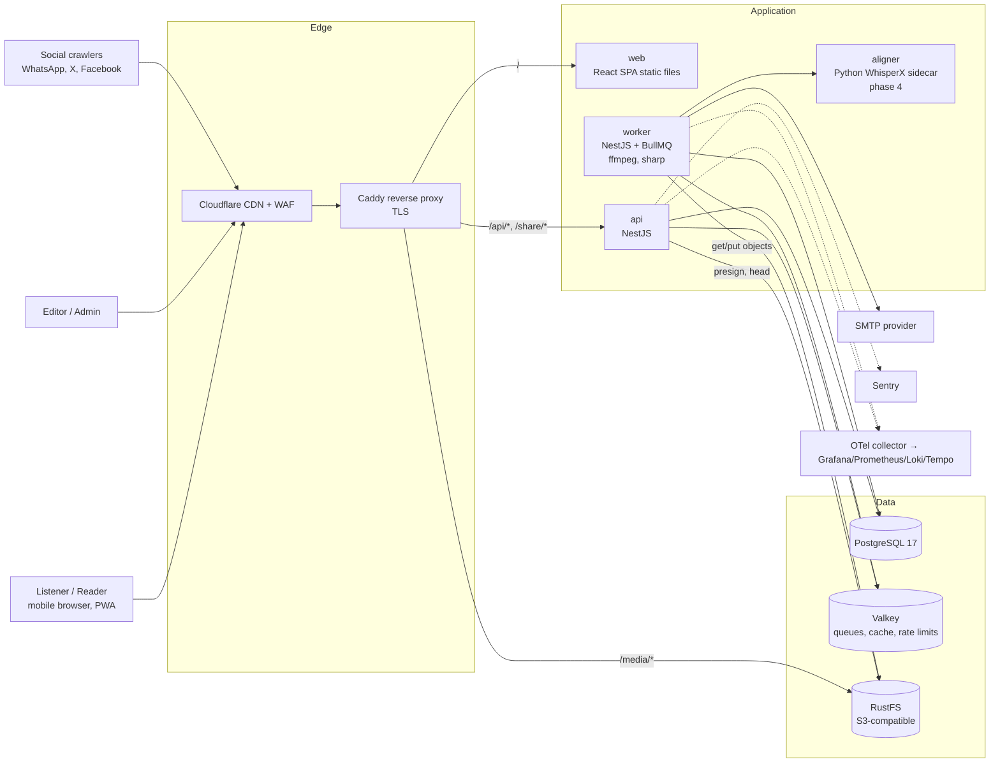
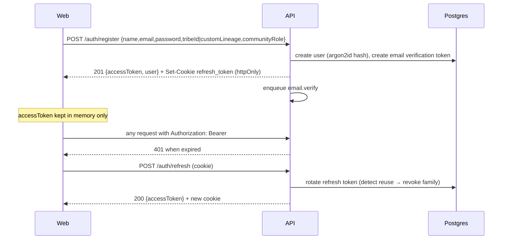
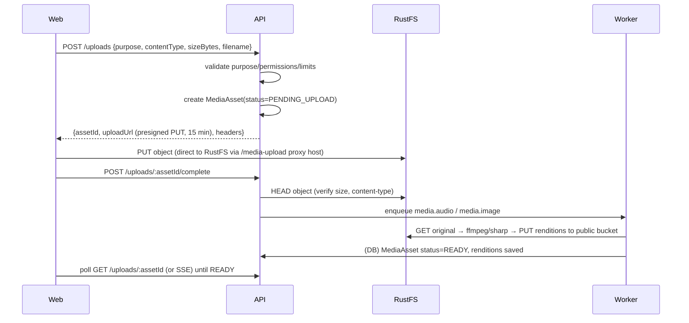

# 01 — Architecture

## 1. System context



## 2. Repository layout (target)

```
ubuntu-tales/
├── apps/
│   ├── web/                 # React + Vite SPA/PWA (public app + /admin console, lazy-loaded)
│   ├── api/                 # NestJS HTTP API
│   └── worker/              # NestJS standalone app running BullMQ processors
├── packages/
│   ├── api-client/          # orval-generated TanStack Query hooks + types (generated, committed)
│   ├── shared/              # constants & enums shared web/api (categories, reactions, limits)
│   ├── db/                  # Prisma schema, migrations, seed, Prisma client export
│   ├── config/              # eslint, tsconfig, prettier, vitest presets
│   └── storage/             # S3/RustFS client wrapper used by api + worker
├── services/
│   └── aligner/             # Python FastAPI forced-alignment service (phase 4)
├── infra/
│   ├── docker/              # Dockerfiles
│   ├── compose/             # docker-compose.dev.yml, docker-compose.prod.yml
│   ├── caddy/               # Caddyfile
│   └── rustfs/              # bucket bootstrap scripts, policies, lifecycle rules
├── docs/production-plan/    # these docs
├── legacy/angular-concept/  # the current concept app, moved here; deleted at parity (Phase 6)
├── turbo.json
├── pnpm-workspace.yaml
└── package.json
```

## 3. Components

### 3.1 `apps/web` — React SPA/PWA
- Public app: onboarding, tribes, home/discover, story detail, read mode, player, celebration, library, saved, profile, auth.
- Admin console under `/admin/*` (lazy-loaded chunk, guarded by `systemRole >= EDITOR`): stories CRUD, narration upload, read-along timing editor, submissions moderation, tribes, story of the day scheduling, users.
- Service worker: precaches app shell; runtime-caches images; stores downloaded stories (JSON + audio) for offline.
- Talks only to `/api/v1/*` via the generated client, and to presigned URLs/CDN for media.

### 3.2 `apps/api` — NestJS
- REST JSON API under `/api/v1`, OpenAPI at `/api/docs` (non-prod) and `/api/openapi.json`.
- Owns auth, business rules, presigned URL issuance, and enqueuing jobs.
- Stateless; horizontally scalable. All state is in Postgres/Valkey/RustFS.

### 3.3 `apps/worker` — NestJS standalone
- BullMQ queues: `media.image`, `media.audio`, `media.align`, `email`, `stats`, `maintenance`.
- Contains `ffmpeg` and `sharp`; the API image does not.

### 3.4 Data stores
- **PostgreSQL**: all relational data. Single primary + streaming replica (phase 5). PITR backups.
- **Valkey**: BullMQ, throttler storage, short-lived caches (home feed, tribe list). Not a system of record; may be flushed safely.
- **RustFS**: images, audio, user uploads. See `04-file-storage-rustfs.md`.

## 4. Key flows

### 4.1 Sign up / sign in / refresh



### 4.2 Read a story with read-along
1. `GET /stories/:slug` returns metadata, structured body, and the default narration with `sentenceTimings[]` and audio rendition URLs.
2. Web player (`HTMLAudioElement`) plays the CDN URL; on `timeupdate` it binary-searches `sentenceTimings` to highlight the active sentence. Tapping a sentence seeks to its `startMs`.
3. Every 15 s, on pause, on `visibilitychange`, and on finish, web calls `PUT /me/progress/:storyId` (debounced, offline-queued).
4. On finish, `POST /me/progress/:storyId/complete` → web navigates to the celebration screen; `POST /stories/:id/reactions` stores the emotion.

### 4.3 Upload media (admin narration or contributor cover image)



### 4.4 Offline download
1. User taps "Download" on a saved story.
2. Web fetches `GET /stories/:slug/offline-bundle` → JSON (story body, timings, metadata, signed media URLs).
3. Web stores the JSON in IndexedDB and fetches audio (data-saver rendition by default) + cover image into a Cache Storage bucket `offline-media-v1`.
4. `POST /me/downloads/:storyId` records the download (for "Offline" filter across devices; files themselves stay per-device).
5. Offline, routes read from IndexedDB; progress updates are queued in IndexedDB and replayed on reconnect (Workbox Background Sync).

### 4.5 Community submission and moderation
`DRAFT → SUBMITTED → IN_REVIEW → (CHANGES_REQUESTED → SUBMITTED)* → APPROVED → PUBLISHED`, or `→ REJECTED`. Contributors edit only in `DRAFT`/`CHANGES_REQUESTED`. Editors review in the admin console. Publishing creates/updates the public `Story` and notifies the author by email.

### 4.6 Social share
`/stories/:slug` link → Cloudflare → Caddy. If user-agent matches crawler list, proxy to `api /share/stories/:slug` which returns minimal HTML with `og:title`, `og:description` (moral), `og:image` (1200×630 rendition). Otherwise serve SPA `index.html`.

## 5. Deployment topology (v1)

- **Environments:** `local`, `staging`, `production`.
- **Production v1:** two app VMs (api ×2 replicas, worker ×1, web static served by Caddy) behind Cloudflare; a managed PostgreSQL (or a dedicated VM with Patroni later); one Valkey; a RustFS cluster of 4 nodes with erasure coding (or 1 node + nightly replication to an off-site S3 bucket for a smaller start). Details in `07-infrastructure-devops.md`.
- **Hosting region:** prefer an African region close to users (e.g. Johannesburg / Cape Town / Lagos providers) to minimise latency; CDN covers the rest.

## 6. Cross-cutting concerns

| Concern | Approach |
| --- | --- |
| Configuration | 12-factor env vars validated with Zod at boot (`@nestjs/config`); web uses `VITE_*` only for public values |
| Correlation | `x-request-id` generated at Caddy, propagated to logs, traces, and job payloads |
| Time | All timestamps `timestamptz` in UTC; client formats locally |
| IDs | UUIDv7 primary keys (sortable); human slugs for stories/tribes |
| Pagination | Cursor-based for feeds and lists (`?cursor=&limit=`) |
| Caching | `Cache-Control` on public GETs (catalogue: `s-maxage=60, stale-while-revalidate=300`); ETags on story detail; immutable for hashed media keys |
| Feature flags | `FeatureFlag` table + `GET /config` endpoint; simple boolean/percentage flags |
| Accessibility | WCAG 2.2 AA; keyboard and screen-reader support for player and read mode |
| Performance budget | Web initial JS ≤ 170 KB gzip; LCP ≤ 2.5 s on Moto G Power / Slow 4G; API p95 ≤ 200 ms for catalogue reads |
