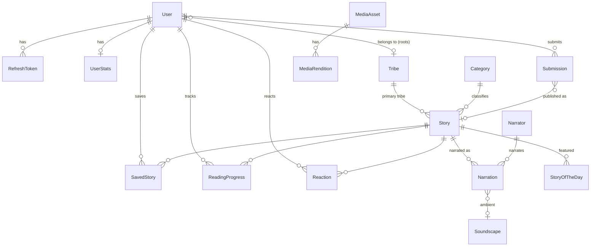

# 02 — Domain Model and Database

PostgreSQL 17, Prisma 6. Schema lives in `packages/db/prisma/schema.prisma`; migrations in `packages/db/prisma/migrations`.

## 1. Domain overview



### Glossary
- **Tribe** — an ethnic group / people (Zulu, Yoruba, Ashanti…). Called "roots" in the UI. Has a region and countries.
- **Story** — a published folktale with structured text.
- **Narration** — an audio recording of a story by a narrator, optionally with per-sentence timings for read-along.
- **Soundscape** — an ambient loop (savanna night, rain, fire) mixed under a narration in the player.
- **Submission** — a community-contributed folktale moving through moderation; on approval it becomes a Story.
- **Community role** — identity badge (Storyteller, Seeker, Writer, Elder/Guardian). **System role** — permissions (READER, CONTRIBUTOR, EDITOR, ADMIN). See ADR-008.

## 2. Story body format (ADR-011)

`Story.body` is JSONB with this exact shape (validated by a shared Zod schema in `packages/shared`):

```json
{
  "version": 1,
  "paragraphs": [
    {
      "id": "p_01",
      "sentences": [
        { "id": "s_0001", "text": "Long ago, when the world was young, the Great Creator fashioned the first trees." },
        { "id": "s_0002", "text": "Each was given a unique gift." }
      ]
    }
  ]
}
```

- Sentence IDs are stable across edits: the editor keeps IDs of unchanged sentences; new sentences get new IDs. This keeps narration timings valid after typo fixes.
- Server splits sentences with `Intl.Segmenter('en', { granularity: 'sentence' })` when an editor saves plain paragraphs; editors can manually merge/split in the admin UI.
- `wordCount` and `readTimeMinutes` (`ceil(words / 200)`) are computed on save.

`Narration.sentenceTimings` JSONB:

```json
[{ "sentenceId": "s_0001", "startMs": 0, "endMs": 4820 }, { "sentenceId": "s_0002", "startMs": 4820, "endMs": 6900 }]
```

## 3. Prisma schema (target for Phase 1–3)

Use this as the starting point. Agents may add fields when a task requires it, documenting them here.

```prisma
generator client {
  provider        = "prisma-client-js"
  previewFeatures = ["fullTextSearchPostgres"]
}

datasource db {
  provider   = "postgresql"
  url        = env("DATABASE_URL")
  extensions = [pg_trgm, unaccent, citext]
}

// ───────────── Enums ─────────────

enum SystemRole {
  READER
  CONTRIBUTOR
  EDITOR
  ADMIN
}

enum CommunityRole {
  STORYTELLER
  SEEKER
  WRITER
  STORYTELLER_AND_SEEKER
  ELDER_GUARDIAN
}

enum UserStatus {
  ACTIVE
  SUSPENDED
  DELETED
}

enum Region {
  NORTH_AFRICA
  WEST_AFRICA
  CENTRAL_AFRICA
  EAST_AFRICA
  SOUTHERN_AFRICA
}

enum StoryStatus {
  DRAFT
  PUBLISHED
  ARCHIVED
}

enum AccessLevel {
  FREE
  PREMIUM
}

enum TimingStatus {
  NONE
  AUTO
  VERIFIED
}

enum ReactionType {
  JOY
  GREAT
  GOOD
  THINKING
  HAPPY
}

enum SubmissionStatus {
  DRAFT
  SUBMITTED
  IN_REVIEW
  CHANGES_REQUESTED
  APPROVED
  REJECTED
  PUBLISHED
  WITHDRAWN
}

enum MediaKind {
  IMAGE
  AUDIO
}

enum MediaPurpose {
  STORY_COVER
  TRIBE_IMAGE
  TRIBE_MASK
  AVATAR
  NARRATOR_AVATAR
  NARRATION_AUDIO
  SOUNDSCAPE_AUDIO
  SUBMISSION_IMAGE
  SUBMISSION_AUDIO
}

enum MediaStatus {
  PENDING_UPLOAD
  UPLOADED
  PROCESSING
  READY
  FAILED
  QUARANTINED
  DELETED
}

enum EmailTokenType {
  VERIFY_EMAIL
  RESET_PASSWORD
}

// ───────────── Identity ─────────────

model User {
  id              String         @id @default(uuid(7)) @db.Uuid
  email           String         @unique @db.Citext
  emailVerifiedAt DateTime?
  passwordHash    String?
  displayName     String         @db.VarChar(80)
  avatarAssetId   String?        @db.Uuid
  tribeId         String?        @db.Uuid
  customLineage   String?        @db.VarChar(120) // free text when "Other / Custom Lineage"
  lineageLabel    String?        @db.VarChar(160) // e.g. "Ashanti & Yoruba Lineage"
  communityRole   CommunityRole?
  systemRole      SystemRole     @default(READER)
  status          UserStatus     @default(ACTIVE)
  sessionVersion  Int            @default(0) // bumped on suspend/password reset; JWT "sv" claim must match
  locale          String         @default("en") @db.VarChar(10)
  onboardedAt     DateTime?
  lastSeenAt      DateTime?
  createdAt       DateTime       @default(now())
  updatedAt       DateTime       @updatedAt
  deletedAt       DateTime?

  tribe          Tribe?            @relation(fields: [tribeId], references: [id])
  avatar         MediaAsset?       @relation("UserAvatar", fields: [avatarAssetId], references: [id])
  refreshTokens  RefreshToken[]
  emailTokens    EmailToken[]
  oauthAccounts  OAuthAccount[]
  stats          UserStats?
  saved          SavedStory[]
  progress       ReadingProgress[]
  reactions      Reaction[]
  downloads      Download[]
  submissions    Submission[]      @relation("SubmissionAuthor")
  reviews        Submission[]      @relation("SubmissionReviewer")
  authoredStories Story[]          @relation("StoryAuthor")
  consents       UserConsent[]

  @@index([tribeId])
}

model RefreshToken {
  id         String    @id @default(uuid(7)) @db.Uuid
  userId     String    @db.Uuid
  familyId   String    @db.Uuid
  tokenHash  String    @unique // sha256 of the opaque token
  userAgent  String?
  ip         String?   @db.Inet
  expiresAt  DateTime
  revokedAt  DateTime?
  replacedById String? @db.Uuid
  createdAt  DateTime  @default(now())

  user User @relation(fields: [userId], references: [id], onDelete: Cascade)

  @@index([userId])
  @@index([familyId])
}

model EmailToken {
  id        String         @id @default(uuid(7)) @db.Uuid
  userId    String         @db.Uuid
  type      EmailTokenType
  tokenHash String         @unique
  expiresAt DateTime
  usedAt    DateTime?
  createdAt DateTime       @default(now())

  user User @relation(fields: [userId], references: [id], onDelete: Cascade)
}

model OAuthAccount {
  id                String @id @default(uuid(7)) @db.Uuid
  userId            String @db.Uuid
  provider          String // "google"
  providerAccountId String
  createdAt         DateTime @default(now())

  user User @relation(fields: [userId], references: [id], onDelete: Cascade)

  @@unique([provider, providerAccountId])
}

model UserConsent {
  id        String   @id @default(uuid(7)) @db.Uuid
  userId    String   @db.Uuid
  type      String   // "terms", "privacy", "analytics", "marketing_email"
  version   String
  granted   Boolean
  createdAt DateTime @default(now())

  user User @relation(fields: [userId], references: [id], onDelete: Cascade)

  @@index([userId, type])
}

model UserStats {
  userId           String   @id @db.Uuid
  talesRead        Int      @default(0) // distinct stories completed
  tribesExplored   Int      @default(0) // distinct tribes of completed stories (+ own tribe)
  listeningSeconds Int      @default(0)
  currentStreakDays Int     @default(0)
  updatedAt        DateTime @updatedAt

  user User @relation(fields: [userId], references: [id], onDelete: Cascade)
}

// ───────────── Catalogue ─────────────

model Tribe {
  id                 String   @id @default(uuid(7)) @db.Uuid
  slug               String   @unique
  name               String   @unique
  region             Region
  countries          String[] // ISO 3166-1 alpha-2, e.g. ["ZA"]
  countriesLabel     String   // display, e.g. "Kenya & Tanzania"
  description        String?
  imageAssetId       String?  @db.Uuid
  maskImageAssetId   String?  @db.Uuid
  themeVariant       String?  // maps to concept "blobClass" e.g. "zulu"
  sortOrder          Int      @default(0)
  isActive           Boolean  @default(true)
  publishedStoryCount Int     @default(0) // denormalised, maintained on publish/unpublish
  createdAt          DateTime @default(now())
  updatedAt          DateTime @updatedAt

  image     MediaAsset? @relation("TribeImage", fields: [imageAssetId], references: [id])
  maskImage MediaAsset? @relation("TribeMask", fields: [maskImageAssetId], references: [id])
  stories   Story[]
  users     User[]
  submissions Submission[]
}

model Category {
  id        String  @id @default(uuid(7)) @db.Uuid
  slug      String  @unique // animal, trickster, wisdom, folklore, creation
  name      String
  badge     String  // "ANIMAL TALE", "TRICKSTER TALE"
  sortOrder Int     @default(0)
  isActive  Boolean @default(true)

  stories     Story[]
  submissions Submission[]
}

model Story {
  id              String      @id @default(uuid(7)) @db.Uuid
  slug            String      @unique
  locale          String      @default("en") @db.VarChar(10)
  title           String      @db.VarChar(160)
  summary         String      @db.VarChar(400)
  moral           String?     @db.VarChar(300)
  body            Json        // see §2
  wordCount       Int
  readTimeMinutes Int
  tribeId         String      @db.Uuid
  categoryId      String      @db.Uuid
  regionLabel     String?     // display override, e.g. "IGBO, NIGERIA"
  coverAssetId    String?     @db.Uuid
  authorUserId    String?     @db.Uuid
  attribution     String?     // "Traditional Yoruba tale, retold by …"
  sourceNotes     String?     // editorial provenance, not public
  status          StoryStatus @default(DRAFT)
  accessLevel     AccessLevel @default(FREE)
  isFeatured      Boolean     @default(false)
  publishedAt     DateTime?
  popularityScore Float       @default(0) // recomputed nightly
  createdAt       DateTime    @default(now())
  updatedAt       DateTime    @updatedAt

  // tsvector column added by raw SQL migration (see §5)
  searchVector    Unsupported("tsvector")?

  tribe      Tribe        @relation(fields: [tribeId], references: [id])
  category   Category     @relation(fields: [categoryId], references: [id])
  cover      MediaAsset?  @relation("StoryCover", fields: [coverAssetId], references: [id])
  author     User?        @relation("StoryAuthor", fields: [authorUserId], references: [id])
  narrations Narration[]
  saved      SavedStory[]
  progress   ReadingProgress[]
  reactions  Reaction[]
  downloads  Download[]
  featuredOn StoryOfTheDay[]
  submission Submission?  @relation("PublishedFrom")
  revisions  StoryRevision[]

  @@index([status, publishedAt(sort: Desc)])
  @@index([tribeId, status])
  @@index([categoryId, status])
  @@index([locale, status])
}

model StoryRevision {
  id        String   @id @default(uuid(7)) @db.Uuid
  storyId   String   @db.Uuid
  editorId  String?  @db.Uuid
  snapshot  Json     // full story fields at publish time
  createdAt DateTime @default(now())

  story Story @relation(fields: [storyId], references: [id], onDelete: Cascade)

  @@index([storyId, createdAt])
}

model Narrator {
  id            String   @id @default(uuid(7)) @db.Uuid
  name          String
  bio           String?
  avatarAssetId String?  @db.Uuid
  userId        String?  @unique @db.Uuid
  createdAt     DateTime @default(now())

  avatar     MediaAsset? @relation("NarratorAvatar", fields: [avatarAssetId], references: [id])
  narrations Narration[]
}

model Soundscape {
  id           String   @id @default(uuid(7)) @db.Uuid
  slug         String   @unique // "savanna-night", "rain", "village-fire"
  name         String
  audioAssetId String   @db.Uuid
  defaultGain  Float    @default(0.25)

  audio      MediaAsset  @relation("SoundscapeAudio", fields: [audioAssetId], references: [id])
  narrations Narration[]
}

model Narration {
  id              String       @id @default(uuid(7)) @db.Uuid
  storyId         String       @db.Uuid
  narratorId      String       @db.Uuid
  locale          String       @default("en") @db.VarChar(10)
  audioAssetId    String       @db.Uuid
  durationMs      Int?
  sentenceTimings Json?        // see §2
  timingStatus    TimingStatus @default(NONE)
  soundscapeId    String?      @db.Uuid
  isDefault       Boolean      @default(false)
  isPublished     Boolean      @default(false)
  createdAt       DateTime     @default(now())
  updatedAt       DateTime     @updatedAt

  story      Story       @relation(fields: [storyId], references: [id], onDelete: Cascade)
  narrator   Narrator    @relation(fields: [narratorId], references: [id])
  audio      MediaAsset  @relation("NarrationAudio", fields: [audioAssetId], references: [id])
  soundscape Soundscape? @relation(fields: [soundscapeId], references: [id])

  @@index([storyId, isPublished])
  // partial unique index "one default narration per story+locale" added in raw SQL
}

model StoryOfTheDay {
  id      String   @id @default(uuid(7)) @db.Uuid
  date    DateTime @db.Date
  locale  String   @default("en") @db.VarChar(10)
  storyId String   @db.Uuid

  story Story @relation(fields: [storyId], references: [id], onDelete: Cascade)

  @@unique([date, locale])
}

// ───────────── User activity ─────────────

model SavedStory {
  userId    String   @db.Uuid
  storyId   String   @db.Uuid
  createdAt DateTime @default(now())

  user  User  @relation(fields: [userId], references: [id], onDelete: Cascade)
  story Story @relation(fields: [storyId], references: [id], onDelete: Cascade)

  @@id([userId, storyId])
  @@index([userId, createdAt(sort: Desc)])
}

model ReadingProgress {
  userId          String    @db.Uuid
  storyId         String    @db.Uuid
  narrationId     String?   @db.Uuid
  lastSentenceId  String?
  audioPositionMs Int       @default(0)
  percent         Int       @default(0) // 0..100
  startedAt       DateTime  @default(now())
  updatedAt       DateTime  @updatedAt
  completedAt     DateTime? // first completion
  completionCount Int       @default(0)
  clientUpdatedAt DateTime  // last-write-wins for offline sync

  user  User  @relation(fields: [userId], references: [id], onDelete: Cascade)
  story Story @relation(fields: [storyId], references: [id], onDelete: Cascade)

  @@id([userId, storyId])
  @@index([userId, updatedAt(sort: Desc)])
}

model ListeningDaily {
  userId  String   @db.Uuid
  day     DateTime @db.Date
  seconds Int      @default(0)

  @@id([userId, day])
}

model Reaction {
  userId    String       @db.Uuid
  storyId   String       @db.Uuid
  type      ReactionType
  createdAt DateTime     @default(now())
  updatedAt DateTime     @updatedAt

  user  User  @relation(fields: [userId], references: [id], onDelete: Cascade)
  story Story @relation(fields: [storyId], references: [id], onDelete: Cascade)

  @@id([userId, storyId])
  @@index([storyId, type])
}

model Download {
  id          String   @id @default(uuid(7)) @db.Uuid
  userId      String   @db.Uuid
  storyId     String   @db.Uuid
  deviceId    String   @db.VarChar(64) // random id generated per browser install
  narrationId String?  @db.Uuid
  rendition   String   // "aac_64k" | "aac_128k"
  createdAt   DateTime @default(now())
  removedAt   DateTime?

  user  User  @relation(fields: [userId], references: [id], onDelete: Cascade)
  story Story @relation(fields: [storyId], references: [id], onDelete: Cascade)

  @@unique([userId, storyId, deviceId])
}

// ───────────── Community submissions ─────────────

model Submission {
  id               String           @id @default(uuid(7)) @db.Uuid
  authorId         String           @db.Uuid
  title            String           @db.VarChar(160)
  tribeId          String?          @db.Uuid
  customTribe      String?          @db.VarChar(120)
  categoryId       String?          @db.Uuid
  bodyText         String           // plain text paragraphs separated by blank lines
  moral            String?          @db.VarChar(300)
  attribution      String?
  coverAssetId     String?          @db.Uuid
  audioAssetId     String?          @db.Uuid
  rightsConfirmed  Boolean          @default(false) // "I have the right to share this"
  licence          String           @default("CC-BY-4.0")
  status           SubmissionStatus @default(DRAFT)
  reviewerId       String?          @db.Uuid
  reviewNotes      String?
  submittedAt      DateTime?
  decidedAt        DateTime?
  publishedStoryId String?          @unique @db.Uuid
  createdAt        DateTime         @default(now())
  updatedAt        DateTime         @updatedAt

  author         User       @relation("SubmissionAuthor", fields: [authorId], references: [id])
  reviewer       User?      @relation("SubmissionReviewer", fields: [reviewerId], references: [id])
  tribe          Tribe?     @relation(fields: [tribeId], references: [id])
  category       Category?  @relation(fields: [categoryId], references: [id])
  publishedStory Story?     @relation("PublishedFrom", fields: [publishedStoryId], references: [id])
  events         SubmissionEvent[]

  @@index([status, submittedAt])
  @@index([authorId, createdAt(sort: Desc)])
}

model SubmissionEvent {
  id           String           @id @default(uuid(7)) @db.Uuid
  submissionId String           @db.Uuid
  actorId      String           @db.Uuid
  fromStatus   SubmissionStatus?
  toStatus     SubmissionStatus
  note         String?
  createdAt    DateTime         @default(now())

  submission Submission @relation(fields: [submissionId], references: [id], onDelete: Cascade)

  @@index([submissionId, createdAt])
}

// ───────────── Media ─────────────

model MediaAsset {
  id           String       @id @default(uuid(7)) @db.Uuid
  kind         MediaKind
  purpose      MediaPurpose
  status       MediaStatus  @default(PENDING_UPLOAD)
  bucket       String
  originalKey  String       @unique
  originalName String?
  contentType  String
  sizeBytes    BigInt
  sha256       String?
  width        Int?
  height       Int?
  durationMs   Int?
  blurhash     String?
  altText      String?
  uploadedById String?      @db.Uuid
  failureReason String?
  createdAt    DateTime     @default(now())
  updatedAt    DateTime     @updatedAt

  renditions MediaRendition[]

  // back-relations
  userAvatars      User[]       @relation("UserAvatar")
  tribeImages      Tribe[]      @relation("TribeImage")
  tribeMasks       Tribe[]      @relation("TribeMask")
  storyCovers      Story[]      @relation("StoryCover")
  narratorAvatars  Narrator[]   @relation("NarratorAvatar")
  narrations       Narration[]  @relation("NarrationAudio")
  soundscapes      Soundscape[] @relation("SoundscapeAudio")

  @@index([status, createdAt])
}

model MediaRendition {
  id          String   @id @default(uuid(7)) @db.Uuid
  assetId     String   @db.Uuid
  variant     String   // "img_320_webp", "img_640_webp", "img_1280_webp", "og_1200x630_jpg", "aac_64k", "aac_128k"
  bucket      String
  key         String   @unique
  contentType String
  sizeBytes   BigInt
  width       Int?
  height      Int?
  bitrateKbps Int?
  createdAt   DateTime @default(now())

  asset MediaAsset @relation(fields: [assetId], references: [id], onDelete: Cascade)

  @@unique([assetId, variant])
}

// ───────────── Platform ─────────────

model FeatureFlag {
  key         String   @id
  enabled     Boolean  @default(false)
  rolloutPct  Int      @default(100)
  description String?
  updatedAt   DateTime @updatedAt
}

model AuditLog {
  id         String   @id @default(uuid(7)) @db.Uuid
  actorId    String?  @db.Uuid
  action     String   // "story.publish", "user.suspend", "submission.approve"
  entityType String
  entityId   String
  metadata   Json?
  ip         String?  @db.Inet
  createdAt  DateTime @default(now())

  @@index([entityType, entityId])
  @@index([actorId, createdAt])
}
```

## 4. Integrity rules enforced in code (and tests)

- `Story.status = PUBLISHED` requires: `coverAssetId` READY, non-empty body, `publishedAt` set.
- `Tribe.publishedStoryCount` is recomputed in the same transaction whenever a story is published, archived, or changes tribe.
- `UserStats` is updated in the same transaction as `ReadingProgress` completion and listening deltas; a nightly `stats.recompute` job corrects drift.
- A `Narration` can be `isDefault` only if `isPublished`.
- Deleting a user (`DELETE /me`) anonymises: sets `status=DELETED`, scrubs email (`deleted+<id>@invalid`), name, avatar; keeps published stories with attribution "Former member". Hard-delete personal activity rows after 30 days (job).

## 5. Raw SQL migrations (add after Prisma's generated SQL)

```sql
-- unaccent is not IMMUTABLE; wrap it so it can be used in a generated column (must be created first)
CREATE OR REPLACE FUNCTION unaccent_immutable(text) RETURNS text
  LANGUAGE sql IMMUTABLE PARALLEL SAFE STRICT AS $$ SELECT public.unaccent('public.unaccent', $1) $$;

-- Full-text search vector
ALTER TABLE "Story" ADD COLUMN IF NOT EXISTS "searchVector" tsvector
  GENERATED ALWAYS AS (
    setweight(to_tsvector('simple', unaccent_immutable(coalesce("title", ''))), 'A') ||
    setweight(to_tsvector('simple', unaccent_immutable(coalesce("moral", ''))), 'B') ||
    setweight(to_tsvector('simple', unaccent_immutable(coalesce("summary", ''))), 'C')
  ) STORED;
CREATE INDEX story_search_idx ON "Story" USING GIN ("searchVector");
CREATE INDEX story_title_trgm_idx ON "Story" USING GIN ("title" gin_trgm_ops);
CREATE INDEX tribe_name_trgm_idx ON "Tribe" USING GIN ("name" gin_trgm_ops);

-- One default narration per story + locale
CREATE UNIQUE INDEX narration_one_default ON "Narration" ("storyId", "locale") WHERE "isDefault";
```

Use the `'simple'` text-search config (not `'english'`) because titles include African names and words that English stemming would mangle. Tribe names are searched via a join + trigram similarity.

### Search query (reference)

```sql
SELECT s.id, ts_rank(s."searchVector", q) + similarity(s.title, $1) AS rank
FROM "Story" s
JOIN "Tribe" t ON t.id = s."tribeId"
CROSS JOIN websearch_to_tsquery('simple', unaccent_immutable($1)) q
WHERE s.status = 'PUBLISHED'
  AND (s."searchVector" @@ q OR s.title % $1 OR t.name % $1)
ORDER BY rank DESC, s."publishedAt" DESC
LIMIT $2;
```

## 6. Seed data

`packages/db/prisma/seed.ts` must be idempotent (upserts by slug) and load:

1. **Categories:** animal ("ANIMAL TALE"), trickster ("TRICKSTER TALE"), wisdom ("WISDOM TALE"), folklore ("FOLKLORE"), creation ("CREATION MYTH").
2. **Tribes:** the 16 in the concept signup list (Zulu, Shona, Yoruba, Ashanti, Maasai, Dogon, San/Khoikhoi, Kuba, Tonga, Igbo, Xhosa, Mandinka, Kikuyu, Amhara, Oromo, Hausa) plus Swahili, with region, countries, theme variant, and images from the concept's `tribe-selection.ts`.
3. **Stories:** every story in the concept (`home.ts`, `library.ts`, `saved.ts`, `celebration.ts`, `read-mode.ts`) with title, tribe, category, region label, moral, cover. For stories with no body in the concept, use a clearly marked placeholder body in **dev/staging only**; production content comes from the editorial team (see roadmap task 6.2).
4. **Narrators** from the concept (Kofi Mensah, Amina Diallo).
5. **Images:** upload `public/assets/images/*.jpg` to RustFS through the same processing pipeline (seed script calls the storage package directly and enqueues `media.image` jobs).
6. **Users (dev/staging only):** `admin@ubuntutales.local` (ADMIN), `editor@…` (EDITOR), and the four concept demo users (Kwame, Thandiwe, Tendai, Amina) as READER with their tribes/roles. Passwords come from `SEED_DEV_PASSWORD` env var. Never seed users in production.

## 7. Database operations

- Connection pooling: PgBouncer (transaction mode) in production; Prisma `?pgbouncer=true&connection_limit=10`.
- Migrations run as a one-off job (`prisma migrate deploy`) before the new API version starts. Migrations must be backward compatible with the previous app version (expand → migrate → contract).
- Statement timeout 5 s for the API role; the worker role gets 60 s.
- Separate DB roles: `ut_app` (DML only), `ut_migrator` (DDL), `ut_readonly` (analytics/support).
