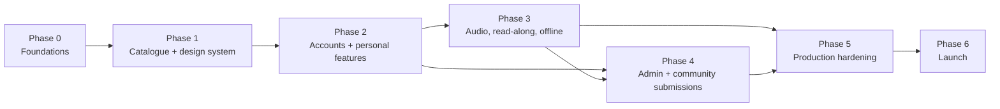

# 10 — Implementation Roadmap

Tasks are sized for one agent / one PR (roughly 0.5–3 days of focused work). Each task lists **Depends on**, **Read**, **Scope**, and **Acceptance criteria (AC)**. Do not start a task until its dependencies are merged. Tasks in the same phase without mutual dependencies can run in parallel (lanes: **BE** backend, **FE** frontend, **OPS** infrastructure, **FS** full-stack).

---

## Phase 0 — Foundations

### 0.1 Monorepo restructure (OPS)
- **Depends on:** —
- **Read:** `01` §2, `README.md` global rules
- **Scope:** Move the Angular concept to `legacy/angular-concept/` (keep it runnable with its own `package.json`). Create pnpm workspace (`pnpm-workspace.yaml`), root `package.json` (`packageManager: pnpm@10.x`), `turbo.json` with `build`, `dev`, `lint`, `typecheck`, `test`, `test:int` pipelines, `.nvmrc` (22), `packages/config` (shared `tsconfig.base.json`, ESLint flat config with `typescript-eslint` strict + `eslint-plugin-react-hooks`, Prettier config reusing `.prettierrc`, Vitest preset). Remove root `package-lock.json`. Update root `README.md` with new dev commands.
- **AC:** `pnpm install` works from clean clone; `pnpm --filter legacy-angular-concept start` still serves the concept; `pnpm lint` and `pnpm typecheck` run (even if no apps yet); no npm lockfile remains.

### 0.2 Local infrastructure (OPS)
- **Depends on:** 0.1
- **Read:** `04` §9, `07` §2
- **Scope:** `infra/compose/docker-compose.dev.yml` with Postgres 17 (init SQL for `pg_trgm`, `unaccent`, `citext`), Valkey 8, RustFS (pinned tag) + `rustfs-init` running `infra/rustfs/bootstrap.sh` (buckets, public-read policy on `ut-media`, CORS on `ut-uploads`), Mailpit. Root scripts `infra:up`, `infra:down`, `infra:reset`. `.env.example` with every variable from `04` §8 and `05` §3.1.
- **AC:** `pnpm infra:up` brings all services healthy; `aws --endpoint-url http://localhost:9000 s3 ls` lists the 3 buckets; an object put in `ut-media` is readable anonymously via `curl`; an anonymous read on `ut-uploads` is denied; re-running bootstrap is idempotent.

### 0.3 CI skeleton (OPS)
- **Depends on:** 0.1
- **Read:** `07` §4
- **Scope:** `.github/workflows/ci.yml` running install (frozen lockfile), lint, typecheck, test, build with pnpm store + Turbo caching. Gitleaks job. Branch protection documented in `docs/runbooks/repo-settings.md`.
- **AC:** CI runs on PRs and is green on the restructured repo; a commit containing a fake AWS key fails Gitleaks.

### 0.4 `packages/db` — Prisma schema and migrations (BE)
- **Depends on:** 0.2
- **Read:** `02` (all)
- **Scope:** Prisma schema from `02` §3, initial migration, raw SQL migration from `02` §5, exported singleton client factory, scripts `db:migrate`, `db:deploy`, `db:reset`, `db:studio`, `db:check`. Shared Zod schema for story body and sentence timings in `packages/shared`.
- **AC:** `pnpm db:migrate` creates all tables, generated `searchVector` column, GIN/trigram indexes, and the partial unique narration index (verified by a test that queries `pg_indexes`). `db:check` fails if schema and migrations drift.

### 0.5 `packages/storage` — RustFS client (BE)
- **Depends on:** 0.2
- **Read:** `04` §3, §7
- **Scope:** Implement `StorageService` per `04` §7 with internal + presign clients. Integration tests with Testcontainers running the pinned RustFS image: presigned PUT with bound content-type/length, HEAD, range GET returns 206, multipart put > 16 MB, delete, `publicUrl`.
- **AC:** All integration tests pass in CI; uploading with a different `Content-Type` or size than signed is rejected; no RustFS-specific code outside this package.

### 0.6 `apps/api` scaffold (BE)
- **Depends on:** 0.4, 0.5
- **Read:** `05` §1–3, `03` §1
- **Scope:** NestJS 11 + Fastify; Zod-validated config; `nestjs-pino` with redaction; ProblemDetails filter + `AppException` + error codes in `packages/shared`; global ValidationPipe; URI versioning `/api/v1`; Swagger at `/api/docs` (non-prod); `openapi:emit` script; Prisma, Valkey, Storage providers; `/health/live`, `/health/ready` (Terminus: DB, Valkey, RustFS); `/config` endpoint; graceful shutdown; Vitest with `unplugin-swc`; Supertest + Testcontainers e2e harness.
- **AC:** `pnpm --filter api dev` starts; `/api/v1/health/ready` reports all three dependencies; a request with an unknown body property returns a Problem Details 400 with `code: VALIDATION_FAILED`; `openapi:emit` writes `packages/api-client/openapi.json` without a running server.

### 0.7 `apps/worker` scaffold (BE)
- **Depends on:** 0.6
- **Read:** `05` §3.7, §4
- **Scope:** Nest application context; BullMQ connection; typed `JobMap` in `packages/shared`; typed producer service used by api; health/metrics HTTP server on `:9464`; graceful shutdown; a `maintenance.ping` sample job with test.
- **AC:** API enqueues a typed job that the worker processes (integration test); `SIGTERM` lets the running job finish; TS error if a job is enqueued with the wrong payload.

### 0.8 `packages/api-client` generation (FS)
- **Depends on:** 0.6
- **Read:** `03` §4
- **Scope:** orval config producing TanStack Query hooks + Zod schemas; custom fetch mutator (`http.ts`) with base URL, in-memory token getter, single-flight 401 refresh + retry once, Problem Details → `ApiError`. `api-client:generate` and `api-client:check` scripts; CI step.
- **AC:** Changing an API DTO without regenerating fails CI; unit tests cover concurrent 401s triggering exactly one refresh.

### 0.9 `apps/web` scaffold (FE)
- **Depends on:** 0.1
- **Read:** `06` §1–2, §7
- **Scope:** Vite + React 19 + TS strict; TanStack Router (file-based) + Query providers; `react-i18next` with `en` namespace; self-hosted Lora and DM Sans; `styles/tokens.css` ported verbatim from concept `src/styles.css`; `base.css`; Vite proxy `/api` → `:3000`; Vitest + RTL + MSW setup; ESLint a11y plugin.
- **AC:** `pnpm --filter web dev` shows a placeholder page using tokens and both fonts; no requests to Google Fonts; a sample component test passes; build output initial JS < 100 KB gzip.

---

## Phase 1 — Catalogue read path and design system

### 1.1 Image processing pipeline (BE)
- **Depends on:** 0.5, 0.7
- **Read:** `04` §5.1, §5.4
- **Scope:** `media.image` processor using `sharp`: sniff type, pixel limit, auto-rotate, strip metadata, renditions per purpose, blurhash, `MediaRendition` rows, asset `READY`/`FAILED`. Shared helper to build `ImageRef` DTOs from an asset.
- **AC:** Fixture JPEG with EXIF GPS → renditions contain no EXIF; `w1280` not produced for a 900 px wide source; decompression-bomb fixture → `FAILED`; `ImageRef.srcset` correct.

### 1.2 Seed data and asset import (BE)
- **Depends on:** 0.4, 1.1
- **Read:** `02` §6
- **Scope:** Idempotent `packages/db/prisma/seed.ts`: categories, tribes, stories, narrators extracted from the concept components (`home.ts`, `library.ts`, `saved.ts`, `celebration.ts`, `tribe-selection.ts`, `read-mode.ts`); upload `legacy/angular-concept/public/assets/images/*` to `ut-uploads` and process to renditions; dev users when `NODE_ENV !== 'production'`. The Baobab story gets the full body from `read-mode.ts`.
- **AC:** `pnpm db:seed` twice yields identical row counts; every story has a READY cover; production mode seeds no users.

### 1.3 Tribes and categories API (BE)
- **Depends on:** 0.6, 1.2
- **Read:** `03` §2.4
- **Scope:** `GET /tribes` (search by name with trigram, region filter), `GET /tribes/:slug`, `GET /categories`; Valkey caching with tag invalidation helper; Cache-Control + ETag interceptors.
- **AC:** e2e tests for filters; second identical request served from cache (verified via metric or spy); `publishedStoryCount` returned.

### 1.4 Stories, search, library, and home API (BE)
- **Depends on:** 1.3
- **Read:** `03` §2.5–2.6, `05` §3.5–3.6, §3.9, `02` §5
- **Scope:** `GET /stories` (filters, sorts, keyset pagination), `GET /stories/search-suggestions`, `GET /stories/:slug` (structured body, ETag), `GET /stories/:slug/recommendations`, `GET /library/*`, `GET /authors/:id`, `GET /home` (story of the day with fallback, your tribe, popular; `continueListening` stubbed until 2.5). Optional-auth decorator wired (viewer overlay added in 2.4/2.5).
- **AC:** e2e tests: accent-insensitive search; category+tribe filter; pagination with no duplicates/skips across 3 pages; drafts never returned; story-of-the-day fallback deterministic for a given date.

### 1.5 Design-system primitives (FE)
- **Depends on:** 0.9
- **Read:** `06` §7
- **Scope:** Build `src/ui` components listed in `06` §7.4 as CSS Modules ported from concept CSS; `Icon` set extracted from concept SVGs; `<Image>` with srcset + blurhash; dev-only `/__ui` gallery route.
- **AC:** Gallery renders every component and variant; axe passes on the gallery; components have RTL tests for interactive behaviour (Dialog focus trap, Tabs keyboard nav, Slider keyboard).

### 1.6 App shell and navigation (FE)
- **Depends on:** 1.5
- **Read:** `06` §3
- **Scope:** Root layout with header, `BottomNav` (hidden on read/listen/complete routes), `NavDrawer`, `Toaster`, route stubs for every route in `06` §3, 404 page, route-level error boundary, scroll restoration.
- **AC:** Every route reachable by URL and via drawer/bottom nav; browser back/forward works; visual comparison of shell vs concept within threshold (`09` §5).

### 1.7 Onboarding and Tribes screens (FE)
- **Depends on:** 1.3, 1.6, 0.8
- **Scope:** `/welcome` (first-visit redirect logic), `/tribes` grid with search and region filter, low-story dialog using `config.lowStoryThreshold`, guest tribe choice stored locally, `/tribes/$slug` page.
- **AC:** First visit lands on `/welcome`, later visits do not; picking a tribe with < 5 stories shows the dialog with both actions working; e2e journey 1 (`09` §4) passes up to home.

### 1.8 Home screen (FE)
- **Depends on:** 1.4, 1.7
- **Scope:** Story of the Day hero, "Your tribe" rail (from guest or account tribe), category pills, story list, search overlay with suggestions and keyword chips, empty state; filters synced to URL; skeleton loading.
- **AC:** Matches concept visually; search debounced and cancellable; `/?q=baobab&category=wisdom` restores state on reload.

### 1.9 Library screen (FE)
- **Depends on:** 1.4, 1.6
- **Scope:** Tabs Stories/Audio/Authors bound to `?tab=`, 4-column responsive grid, real infinite scroll, "Submit Story" CTA (links to `/submit`, gated later).
- **AC:** Scrolling to bottom loads next page exactly once; tab switch preserves each tab's loaded pages; e2e journey 5 passes.

### 1.10 Read mode — text only (FE)
- **Depends on:** 1.4, 1.6
- **Scope:** `/stories/$slug` rendering structured body with sentence spans, font-size cycling (persisted), bookmark button (gated later), header actions, "Finish story" → `/stories/$slug/complete` (stub), scroll-based reading position. Remove global `user-select: none` for story text.
- **AC:** Deep link works on reload; text selectable; font size persists; Lighthouse a11y ≥ 95 on this route.

### 1.11 Share pages and OG previews (BE)
- **Depends on:** 1.4, 1.1
- **Read:** ADR-009, `05` §3.9 (share page)
- **Scope:** `GET /share/stories/:slug` HTML with escaped OG/Twitter tags; `og_1200x630` rendition; Caddy crawler routing snippet in `infra/caddy`.
- **AC:** Test with WhatsApp UA returns OG tags; a story title containing `<script>` is escaped; normal browsers get the SPA.

---

## Phase 2 — Accounts and personal features

### 2.1 Auth backend (BE)
- **Depends on:** 0.6, 0.7
- **Read:** `05` §3.2–3.3, `03` §2.2, `08` §1–3
- **Scope:** Register (optional tribe + consents + age confirmation), login, refresh (rotation + reuse detection), logout, logout-all, verify email, resend, forgot/reset password, HIBP check, lockout, guards (`JwtAuthGuard`, `RolesGuard`, `@Public`, `@OptionalAuth`, `@CurrentUser`), Ed25519 JWT with `kid`. `email.send` processor with React Email templates + Mailpit in dev.
- **AC:** All auth cases in `09` §3 pass as e2e tests; refresh cookie attributes asserted; passwords never logged (log-capture test).

### 2.2 Web auth (FE)
- **Depends on:** 2.1, 0.8, 1.6
- **Read:** `06` §3–4
- **Scope:** `sessionStore`, boot-time refresh, `/login`, `/signup` (tribe optional with consent wording, community role select, age confirmation), `AuthModal` + `requireAuth(action)` that resumes the action after login, `/verify-email`, `/forgot-password`, `/reset-password`, logout. Guest data merge (tribe, saved, progress) after login/signup.
- **AC:** e2e journey 2 passes; reloading keeps the user signed in via refresh cookie; no token in localStorage/sessionStorage (asserted in e2e); demo quick-login chips exist only when `import.meta.env.DEV`.

### 2.3 Profile, settings, and `/me` (FS)
- **Depends on:** 2.2
- **Read:** `03` §2.3
- **Scope:** `GET/PATCH /me`, onboarding complete, change password, avatar via upload (stub until 3.1 → use initials avatar), profile sheet with stats cards (matches concept profile modal), `/settings` (account, language, data saver placeholder, sign out everywhere).
- **AC:** Changing tribe on profile updates "Your tribe" on home without reload; stats render from API.

### 2.4 Saved stories (FS)
- **Depends on:** 2.2, 1.4
- **Scope:** Saved endpoints; `viewer.saved` overlay on story cards; optimistic save/unsave; `/saved` with filters All / In progress (offline filter wired in 3.8); empty states.
- **AC:** Saving from home, read mode, or celebration reflects everywhere instantly; e2e covers save → appears in `/saved`.

### 2.5 Reading progress and stats (FS)
- **Depends on:** 2.4
- **Read:** `05` §3.9 (progress & stats)
- **Scope:** Progress PUT with last-write-wins and delta caps, complete endpoint, `UserStats` + `ListeningDaily` updates, streak, nightly `stats.recompute` job, `continueListening` on home, progress bars on cards/saved. Web `useProgressSync` for text reading (audio hooks added in 3.5).
- **AC:** Progress/stats tests in `09` §3 pass; reading half a story on one browser shows ~50% on another.

### 2.6 Celebration, reactions, recommendations (FS)
- **Depends on:** 2.5
- **Scope:** Reaction upsert/delete/summary endpoints; `/stories/$slug/complete` screen ported from concept (reaction picker with labels/meanings from `/config`, recommendations from `/complete` response, Share Wisdom dialog using Web Share API with copy-link fallback, `POST /stories/:id/share`); reflection tag shown on Saved cards.
- **AC:** Selecting a reaction persists across reload; share uses native sheet on mobile and copies link on desktop; e2e journey 3 passes (minus audio).

### 2.7 Google sign-in (BE + FE, optional for launch)
- **Depends on:** 2.2
- **Scope:** OAuth 2.0 PKCE flow, `OAuthAccount` linking by verified email, button on login/signup.
- **AC:** New Google user lands on onboarding with tribe step; existing email account links instead of duplicating.

---

## Phase 3 — Audio, read-along, uploads, offline

### 3.1 Uploads API and web upload component (FS)
- **Depends on:** 0.5, 2.1
- **Read:** `04` §4, `03` §2.9
- **Scope:** `POST /uploads`, `/complete`, `GET` status (+ optional SSE); per-purpose policy table; quotas; cleanup job for stale `PENDING_UPLOAD`; web `UploadField` (direct PUT with progress, retry, status polling). Enable avatar upload in profile.
- **AC:** Disallowed type/size rejected before presign; completing without an object → `UPLOAD_NOT_FOUND_IN_STORAGE`; avatar upload works end to end; stale uploads removed by the job.

### 3.2 Audio processing pipeline (BE)
- **Depends on:** 3.1, 0.7
- **Read:** `04` §5.2, §5.4
- **Scope:** `media.audio` processor: ffprobe validation, master copy to `ut-private`, loudnorm two-pass, `aac_64k`/`aac_128k` (+ soundscape `aac_96k`), faststart, duration; worker Docker image with static ffmpeg.
- **AC:** Fixture WAV → two renditions with expected codec/bitrate/channels (asserted via ffprobe in test); corrupt file → `FAILED` with reason; memory stays bounded on a 200 MB fixture (streamed).

### 3.3 Narrations, narrators, soundscapes — API (BE)
- **Depends on:** 3.2, 1.4
- **Read:** `03` §2.5 (`NarrationDetail`), §2.10 (narration admin endpoints)
- **Scope:** Admin endpoints for narrators, soundscapes, attaching narrations, timings PATCH with validation (monotonic, non-overlapping, sentence IDs exist); `defaultNarration` + `listenTimeMinutes` + `hasAudio` in story responses; CLI `pnpm media:import-narration --story <slug> --file <path> --narrator <name>` for dev/staging until the admin UI exists (4.3). Seed one narration with hand-made timings for the Baobab story.
- **AC:** Invalid timings rejected with field errors; story detail includes rendition URLs reachable from the browser.

### 3.4 Audio engine, mini player, full player (FE)
- **Depends on:** 3.3, 1.10
- **Read:** `06` §5.1
- **Scope:** `AudioEngine` singleton, `playerStore`, rendition selection (data saver / connection), `MiniPlayer` in shell and read mode, `/stories/$slug/listen` full player ported from concept (seek slider, ±15 s, speed cycle, soundscape toggle via Web Audio gain), Media Session API, keyboard shortcuts.
- **AC:** Playback continues across route changes; lock-screen controls work on Android Chrome; speed and seek work on iOS Safari (manual QA note in PR); unit tests for engine state transitions.

### 3.5 Read-along sync and audio progress (FE)
- **Depends on:** 3.4, 2.5
- **Read:** `06` §5.2
- **Scope:** `useReadAlong` (binary search, rAF throttle, auto-scroll with manual-scroll pause, tap-to-seek); `useProgressSync` for audio (15 s cadence, pause, `visibilitychange` keepalive, `ended` → complete → celebration).
- **AC:** Unit tests for boundary timings; e2e journey 3 passes fully with real audio; listening time on profile increases by roughly the time listened.

### 3.6 PWA shell and caching (FE)
- **Depends on:** 1.6
- **Read:** `06` §6
- **Scope:** `vite-plugin-pwa` injectManifest, manifest + maskable icons, precache, runtime caching rules, update toast, install prompt UX (non-intrusive, after second story).
- **AC:** Lighthouse PWA installable; reload offline shows app shell + offline banner; new deploy triggers update toast.

### 3.7 Offline downloads (FS)
- **Depends on:** 3.6, 3.4, 2.4
- **Read:** `06` §6, `01` §4.4
- **Scope:** `GET /stories/:slug/offline-bundle`, downloads endpoints, `deviceId`, download manager with progress, IndexedDB + Cache Storage, `RangeRequestsPlugin`, storage usage + "remove all downloads" in settings, "Offline" filter in `/saved`.
- **AC:** e2e journey 4 passes (download → offline → read + play + seek); removing a download frees cache entries.

### 3.8 Offline write queue (FE)
- **Depends on:** 3.7, 2.6
- **Scope:** IndexedDB outbox for progress, reactions, save/unsave; replay on reconnect / Background Sync; idempotency keys; UI shows pending sync state.
- **AC:** Actions taken offline appear server-side after reconnect (e2e); duplicate replays do not double-count stats.

---

## Phase 4 — Admin console and community submissions

### 4.1 Admin shell and dashboard (FS)
- **Depends on:** 2.2
- **Read:** `06` §9, `03` §2.10
- **Scope:** Lazy `/admin` route tree with role guard, sidebar layout, `GET /admin/metrics/overview`, dashboard cards.
- **AC:** READER gets 403 page; admin chunk not included in the public initial bundle (bundle analysis in CI).

### 4.2 Story editor and publishing workflow (FS)
- **Depends on:** 4.1, 3.1
- **Scope:** Admin stories list/filters; editor (paragraph editor, sentence splitting with stable IDs, cover upload, metadata); preview as reader; publish/unpublish/archive with validation (`STORY_NOT_PUBLISHABLE`), `StoryRevision`, `AuditLog`, cache invalidation, `Tribe.publishedStoryCount` maintenance.
- **AC:** Editing one sentence keeps all other sentence IDs (unit test); publishing appears on home within 60 s; audit log entry written per transition.

### 4.3 Narration management and timing editor (FS)
- **Depends on:** 4.2, 3.3
- **Scope:** Narration upload/attach UI with processing status, set default/publish, soundscape selection; `wavesurfer.js` timing editor with tap mode and region drag; mark `VERIFIED`.
- **AC:** e2e journey 7 passes; timing editor works with keyboard only.

### 4.4 Catalogue admin: tribes, categories, narrators, soundscapes, story of the day (FS)
- **Depends on:** 4.1, 3.1
- **Scope:** CRUD screens + endpoints; Story of the Day calendar.
- **AC:** Scheduling tomorrow's story changes the home hero on that date (test with mocked clock).

### 4.5 Transactional outbox (BE)
- **Depends on:** 0.7, 2.1
- **Read:** `05` §3.7
- **Scope:** `OutboxEvent` model + migration, `OutboxService.add(tx, event)`, worker poller (SKIP LOCKED), retry, metrics. Migrate auth emails to the outbox.
- **AC:** Killing the worker mid-flight does not lose or duplicate emails (integration test with restarts).

### 4.6 Submissions API and state machine (BE)
- **Depends on:** 4.5, 3.1
- **Read:** `03` §2.8, §2.10, `05` §3.9 (submissions)
- **Scope:** Contributor endpoints, admin moderation endpoints, state machine with exhaustive tests, approval → draft story, publish → submission `PUBLISHED`, role upgrade to CONTRIBUTOR, notification emails via outbox, `SubmissionEvent` history.
- **AC:** 100% transition coverage; non-owners get 404 (not 403) for others' submissions.

### 4.7 Submission UI (FE)
- **Depends on:** 4.6
- **Scope:** `/submit` multi-step form (story text, tribe or custom tribe, category, moral, attribution, cover image, optional audio, rights + licence), autosave draft, `/me/submissions` list with statuses and reviewer notes, resubmit after changes requested. Library "Submit Story" CTA routes here (verified email required).
- **AC:** Draft survives reload; validation mirrors API (150–5,000 words).

### 4.8 Moderation queue UI (FE)
- **Depends on:** 4.6, 4.1
- **Scope:** Queue by status, claim, side-by-side view, actions with notes, link to resulting draft story.
- **AC:** e2e journey 6 passes.

### 4.9 Users admin, feature flags, audit log (FS)
- **Depends on:** 4.1
- **Scope:** ADMIN screens and endpoints; suspension increments session version (immediate token invalidation).
- **AC:** Suspended user's next API call returns 401 and refresh fails.

### 4.10 Auto-alignment service (BE, behind flag `auto_align`)
- **Depends on:** 4.3
- **Read:** `04` §5.3
- **Scope:** `services/aligner` (FastAPI + WhisperX or aeneas, Dockerised), `media.align` processor, "Auto-align" button in timing editor, validation of returned timings.
- **AC:** On the Baobab fixture, ≥ 90% of sentence starts within 300 ms of hand-made timings; failure leaves `timingStatus` unchanged.

---

## Phase 5 — Production hardening

### 5.1 Security hardening (BE + OPS)
- **Depends on:** Phases 2–4
- **Read:** `08` §1–2
- **Scope:** Complete the `08` §2 checklist; TOTP 2FA required for EDITOR/ADMIN; ClamAV scanning (`clamd` sidecar) for submission uploads → `QUARANTINED`; story report endpoint + admin queue; split RustFS credentials (`ut-api` / `ut-worker`); OWASP ZAP baseline in CI against staging.
- **AC:** Checklist items ticked with links to evidence (tests/config); ZAP baseline has no high findings; EICAR test file is quarantined.

### 5.2 Privacy features and legal pages (FS)
- **Depends on:** 2.3
- **Read:** `08` §3
- **Scope:** Consents API + settings UI, analytics consent banner (PostHog loads only after consent), `GET /me/export` job + email, `DELETE /me` + anonymisation job, retention cleanup jobs, `/legal/*` pages rendered from markdown, cookie/storage disclosure.
- **AC:** Export ZIP contains profile, saved, progress, reactions, submissions; deleted user cannot log in and is anonymised in DB; no analytics network calls before consent (e2e).

### 5.3 Observability (OPS + BE)
- **Depends on:** 0.6, 0.7
- **Read:** `05` §5, `07` §7
- **Scope:** OTel SDK in api/worker, Collector config, Prometheus metrics, Grafana dashboards (API, jobs, DB, RustFS, web vitals), Sentry (web/api/worker) with source maps, alert rules from `07` §7, external uptime checks.
- **AC:** A request trace shows API → Prisma → job → worker spans; each alert rule has been fired once in staging (documented).

### 5.4 Production infrastructure and deploy pipelines (OPS)
- **Depends on:** 5.3
- **Read:** `07` §3–6, `04` §10
- **Scope:** Provision staging and production per `07` §5 (IaC with Terraform/OpenTofu where the provider supports it), RustFS cluster, Cloudflare config, Caddy, production Dockerfiles with non-root/read-only FS, image signing/SBOM/Trivy, `deploy-staging.yml`, `deploy-production.yml` with migrate → roll → smoke → auto-rollback, Postgres PITR, RustFS off-site sync, runbooks in `07` §8.
- **AC:** Tag deploy to production with zero failed requests during rollout (k6 running during deploy); restore drill from backup succeeds and is logged; off-site sync dead-man alert fires when sync is stopped.

### 5.5 Accessibility and i18n audit (FE)
- **Depends on:** Phases 1–4 UI
- **Scope:** axe on all e2e pages, manual screen-reader pass (TalkBack + VoiceOver) on core journeys, fix findings; ensure 100% of UI strings are in locale files (lint rule `i18next/no-literal-string`); pseudo-locale build to catch truncation.
- **AC:** Zero axe violations (serious/critical); pseudo-locale renders without layout breakage on core screens.

### 5.6 Performance and load (FS)
- **Depends on:** 5.4
- **Read:** `06` §12, `09` §6
- **Scope:** Lighthouse CI budgets enforced; bundle splitting fixes; image size audit; DB query review with `EXPLAIN ANALYZE` on top 10 queries; k6 tests from `09` §6 on staging sized like production.
- **AC:** All budgets and load targets met; results committed to `perf/results/`.

---

## Phase 6 — Launch

### 6.1 Visual parity sign-off and legacy removal (FE)
- **Depends on:** Phase 3, 4.7
- **Read:** `09` §5
- **Scope:** Final side-by-side visual review vs concept; resolve or sign off differences; delete `legacy/angular-concept` and concept baselines; update README.
- **AC:** Design sign-off recorded in PR; repository contains no Angular code.

### 6.2 Content readiness (editorial, non-code with admin tooling support)
- **Depends on:** 4.2, 4.3
- **Scope:** Editorial team loads real story texts (replacing dev placeholders), cultural review, narrations recorded and timings verified, Story of the Day scheduled 60 days ahead, every launch tribe has ≥ 5 stories or is hidden (`isActive=false`). Agents support with bulk-import script (`pnpm content:import ./content/*.json`) validated against the story body schema.
- **AC:** ≥ 60 published stories across ≥ 12 tribes, ≥ 30 with verified narrations; no placeholder text in production (`content:lint` script).

### 6.3 Launch checklist (OPS + FS)
- **Depends on:** 5.x, 6.1, 6.2
- **Scope:** Verify: backups + restore drill done; alerts routed to on-call; runbooks reviewed; legal pages live; security.txt; status page; production smoke test; error budget/SLOs documented (99.5% monthly availability for API, 99.9% for media); soft launch to a closed beta (feature flag `public_signup`), then public.
- **AC:** Checklist committed to `docs/runbooks/launch-checklist.md` with every item ticked and dated.

---

## Post-launch backlog (not scheduled)

Native apps (React Native/Expo reusing `api-client` and `shared`), additional content languages (isiZulu, Yoruba, Kiswahili, Hausa, Amharic) with per-locale narrations, collaborative-filtering recommendations, HLS adaptive streaming, premium subscriptions via `EntitlementsService` (Paystack/Flutterwave for African payments), comments/discussion circles, narrator applications, kids mode, Meilisearch if search outgrows Postgres.
